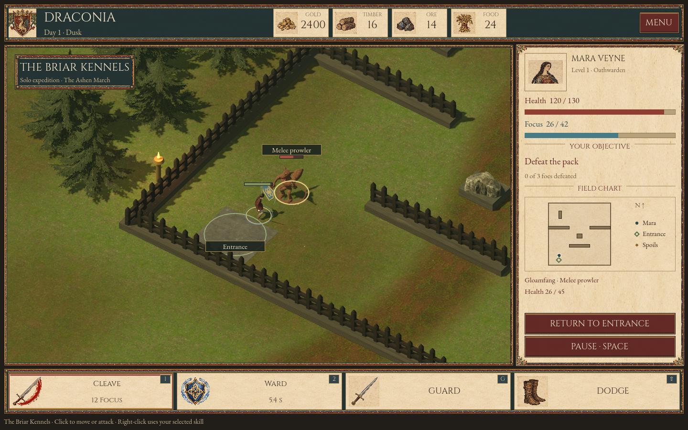
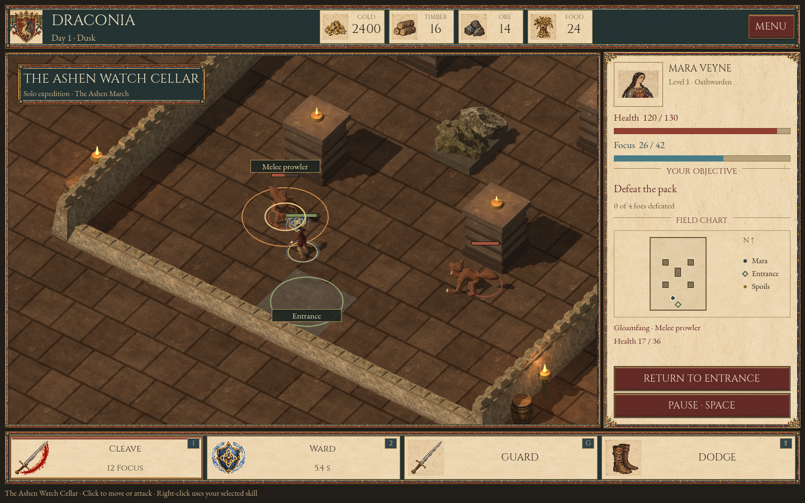
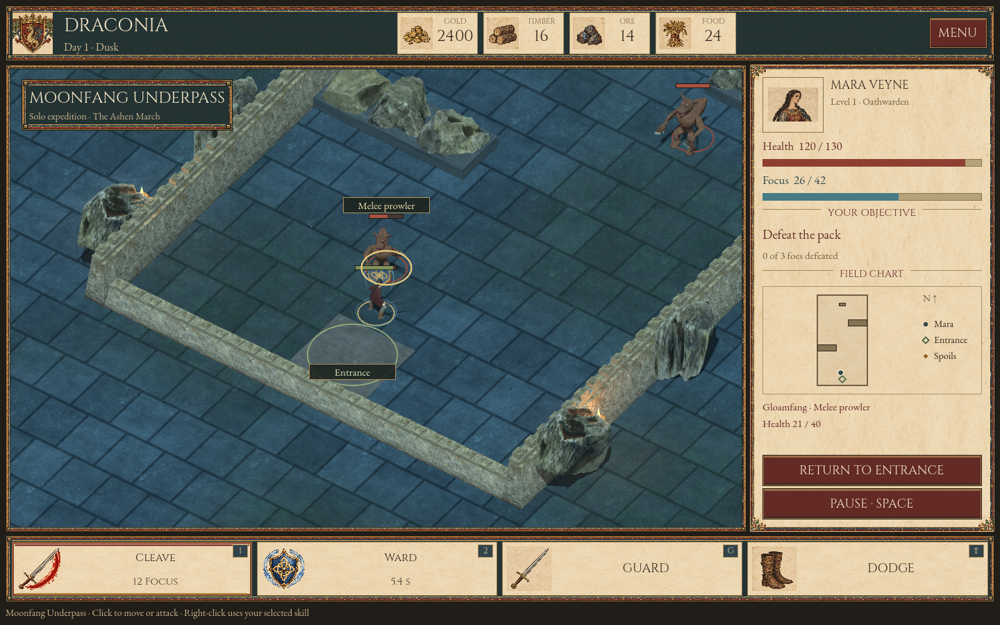

# Draconia 0.3.2 — Hunt locations and expedition field guide

Released as a Godot source update on 22 October 2026. Download the complete
repository ZIP, extract it, import `project.godot` into standard Godot 4.7.2,
allow the assets to import, and press F5. The game remains a playable
development slice built around one campaign hero, Mara Veyne.

## What changes in play

Fresh hunt boards now offer three different registered locations. Each has its
own bounds, obstacles, entry, pack placement, lighting and native 3D dressing.
The same arena definition supplies movement collision, visible interior
barriers, extraction and the field chart.

| Hunt | Environment | Tactical difference |
| --- | --- | --- |
| The Briar Kennels | Timber pens, woodland, kennel shelters and warm light | Divided yards offer routes around the pack; the keeper has room to leap. |
| The Ashen Watch Cellar | Firelit masonry, four stone piers, barrels and rubble | Four hunters approach through side aisles; the piers interrupt direct pursuit. |
| Moonfang Underpass | Cold stone, rock shoulders and a long narrow passage | Alternating obstacles shape the escape lanes against two leaping hunters. |

These locations reuse the project's existing licensed model and material
assets. Fires, banners and ambient motes animate in the native scene. The
original painted town cards remain the architectural reference for Dawnreach.

### The field guide

The manuscript sidebar now shows the actual arena footprint, Mara, the
entrance and unclaimed spoils. It does not supply enemy map markers. The
objective follows the real action state through three stages: defeat the
pack, collect remaining rewards, then return to Dawnreach. The story vault
uses its own guardian wording.

Selecting a foe shows its current Health and whether it is a melee prowler or
a leaping hunter. A ground marker reflects accepted movement destinations,
including movement after combat. A queued order does not create a fictitious
destination before it executes. The entrance has a projected label at its
registered position.

During collection, the chart becomes shorter and the completed combat target
readout disappears. Compact manuscript reward controls keep all three hunt
rewards visible above the Return and Pause actions. Rewards dropped at one
position share one physical chest. That chest remains until the final reward
at the position is collected; the ledger still tracks each item or gold claim
independently.

## Movement and compatibility fixes

Testing found a reproducible fence-corner stall. The previous path check
sampled a long line at 0.12-unit intervals and could miss a very small corner
intersection. Shorter movement steps detected the wall, leaving an accepted
route stuck. Clearance now tests the complete segment against the actor's
radius-expanded obstacles. The pathfinder also validates its final segment,
connects its first links from the actor's actual position, and finds a
different approach when an attack approach point falls inside a pier.

The campaign save version is now 5 and the current hunt registry is version
2. Pending, withdrawn and defeated version-1 contracts retain their original
vault geometry, spawns, wounds, attempts and reward claims. Completing the old
contract produces a new location board. A validated, untouched old board can
upgrade immediately, retaining its generation, tier, reward rolls and history.

A real older runtime also produced a saved corner-grazing path that stricter
validation would otherwise reject. Its authentic fixture now protects that
case. Loading preserves the saved action snapshot. When movement resumes, the
obsolete route replans toward its original destination. Committed actions,
pause, root effects, RNG and rewards retain their normal behavior. New
movement commands always use exact clearance.

## Actual Godot screenshots

These are captures of the running game, not concept art. The following three
use the normal dungeon camera distance. The evidence folder also contains
zoomed-out location views and the collection/extraction states.

### Briar Kennels



### Ashen Watch Cellar



### Moonfang Underpass



## Verification

### Rules gate

Eight isolated suites pass **1,879 checks with zero failures and zero engine
error diagnostics**. The portable runner verifies its separate application
data identity before running each suite and records the copied source hashes.
The final invocation also verified a relative Godot executable path while
running outside the repository.

| Suite | Checks |
| --- | ---: |
| Realm | 247 |
| Hunts | 459 |
| Progression | 277 |
| Hero identity | 134 |
| Items | 73 |
| Action rules | 232 |
| Dungeon catalog | 381 |
| Expedition guidance | 76 |
| **Total** | **1,879** |

Coverage includes combat, physical pickups and extraction in all three
locations; radius-aware navigation; partial-claim save and deterministic
continuation; retreat, defeat and recovery; registered rewards and sales;
class restrictions; corrupted save rejection; and earned progression to level
30 through 46 hunt completions followed by a capped-level run. Frozen fixtures
from the published previous source protect both a committed Ward's exact
continuation and the older saved movement route.

Reproduce the logic gate from the repository:

```bash
python tools/run_rules.py --godot /path/to/godot
```

An optional `--output-dir` retains the isolated projects, reports and raw logs
at a chosen path. The runner requires Python 3.8 or later. It copies rules and
small fixtures into temporary projects; it does not load player saves or copy
the large asset tree. This is separate from native rendering verification.

### Native presentation gate

The final native run passes **176 checks with zero failures** and produces
**ten captures**. It uses the actual game shell, real registered encounters,
legal model commands, camera projection/object picking and the game's
collection/extraction callbacks. All three packs are defeated, all nine
registered reward claims are collected, and each location is exited through
one return request.

Checks include the actual transformed obstacle mesh bounds, correct entrance
placement and picking, exact saved loot anchors, shared chest lifetime,
selected-target guidance, objective changes, and visible small-window reward
controls. Default-camera views and collection/extraction views were visually
reviewed after correcting asset placement, wall orientation, exposed ground
edges, overlapping chests, clipped controls and a procedural button-style
copy issue.

The tested window sizes are 1440×900, 1280×800 and 960×640. The existing fixed
aspect ratio gives the smallest window 960×600 of game content with 20-pixel
letterbox bars. PNGs capture that rendered content. The native route uses
software OpenGL/Mesa and Dummy audio; it is a scene/HUD integration test,
not a complete operating-system-input playthrough, audio acceptance test or
target-hardware performance benchmark.

The final Godot editor import exits 0 with no errors or warnings. The native
run's only engine warning is unsupported V-Sync control on the virtual display.

### Retained evidence

- [Review and source/evidence hashes](hunt-regions-v032/review.json)
- [Portable rules report](hunt-regions-v032/rules/report.json)
- [Rules summary](hunt-regions-v032/rules/summary.json)
- [Native report and capture index](hunt-regions-v032/native/report.json)
- [Native engine output](hunt-regions-v032/native/engine.txt)
- [Final editor import output](hunt-regions-v032/editor-import.txt)
- [Frozen-save fixture provenance](../tests/fixtures/dungeons/README.md)

Earlier test and export records remain in [VERIFICATION.md](VERIFICATION.md)
with their original scope. Their assertion totals are not added to this gate.

## Remaining production work

This update improves the repeatable dungeon loop and its reliability. It does
not establish Heroes III breadth or AAA production quality. The locations
currently reuse the existing creature family; wider enemy variety, authored
boss encounters, richer environment detail, additional playable classes and
factions, final character art, broader animation review and target-hardware
testing remain substantial work. At small resolution, the shared-reward world
label can cross a busy corpse/rock background; the sidebar supplies readable
individual reward actions.

The current deliverable is the Godot project. Previous desktop executables
remain their recorded historical builds. The test results are concrete
regression evidence, not a promise that the project contains no bugs.
