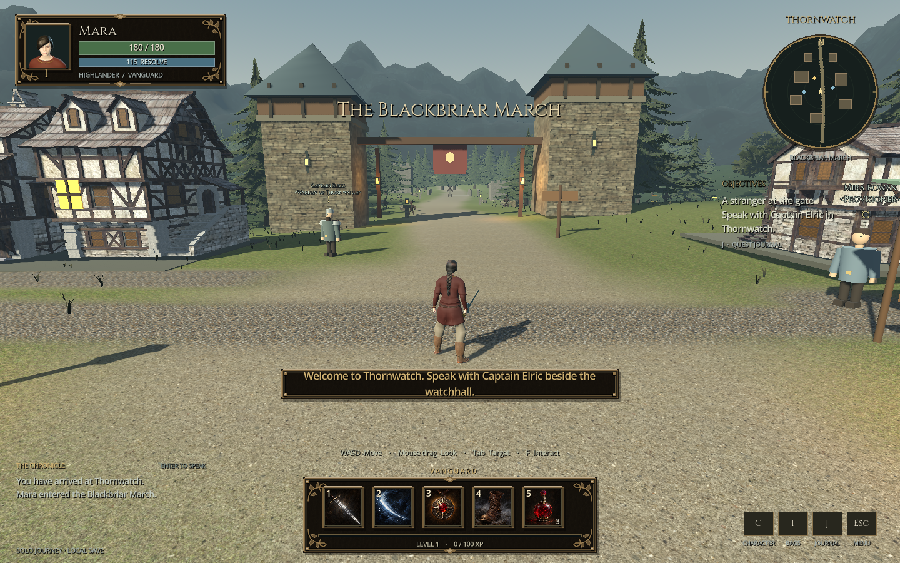
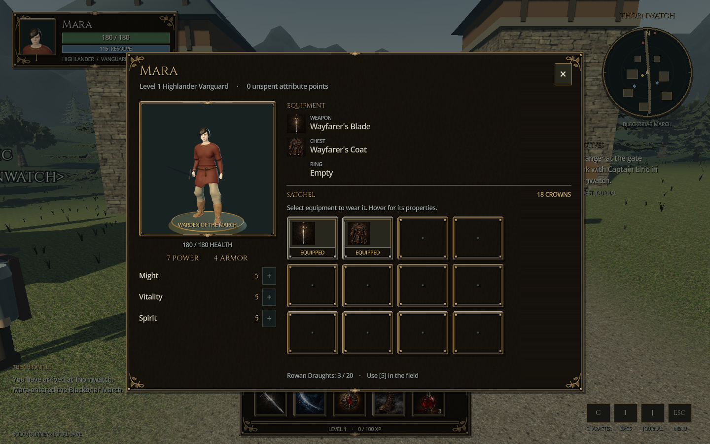
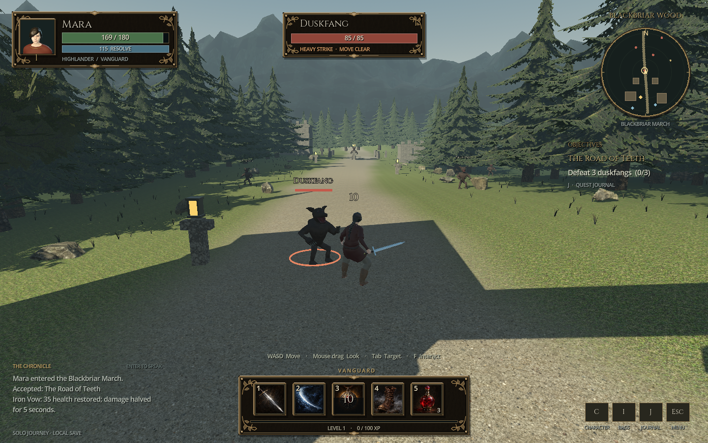

# Third-person reboot — release review

Version: **0.4.0-third-person**

Review date: **22 October 2026**

Engine used: **Godot 4.7.2 stable**, native GL Compatibility

Entry scene: **`res://online.tscn`**

## What this release establishes

The active game is rebuilt as a third-person RPG around the accepted animated
Mara character. The old strategy/isometric runtime is retired. This version
provides a new region, native interface, authoritative combat and progression,
three quest chapters, solo saves, and private ENet realms. It is a playable
foundation rather than a completed AAA MMORPG.

The original `assets/models/mara/mara.glb` is unchanged, as are its retained
materials and equipment dependencies. Its SHA-256 is:

```text
8ada77b97e748814283fbf3f6efe960026674c0bf4ed04776610515c70fac94d
```

The presenter uses the existing 53-bone skeleton and all twelve animation clips.
The sword hides during the unarmed cast, roll, and death motions, then restores.
Physical jumping uses the existing pose; no authored jump animation was added.

## Recorded verification

The JSON receipts below are copied from the actual runs. Counts are assertions
inside bounded suites; they are not a claim of exhaustive testing or zero bugs.

| Gate | Result | Evidence and scope |
|---|---|---|
| Authoritative rules | **130 checks passed** | [Rules receipt](verification/rules.json). Input validation, movement/collision, timed combat, all three quests, boss, ownership, rewards, attributes, equipment, saves, death, and chat. |
| World and animation contract | **97 checks passed** | [World receipt](verification/world.json). Exact model hash, all clips, finite poses and blending, locomotion phase, weapon policies, enemy contact continuity, interaction ranges, shared prop collision, and spring-arm obstruction. |
| Native interface fixture | **11 checks passed** | [UI receipt](verification/ui.json). Pointer and keyboard dispatch, attribute commit, chat focus, party frames, maximum level, death recovery, and eight inspected fixture captures. |
| Native shipped solo scene | **55 checks passed** | [Native report](verification/native.json), [acceptance receipt](verification/acceptance.json). The actual F5 scene, movement, panels, quests, abilities, chat, save/re-entry, death while paused, respawn, and two window sizes. Seven actual viewport captures are included below. |
| Independent-process ENet | **46 checks passed** | [Transport report](verification/network.json). Five process runs, including two simultaneous remote clients, late join, duplicate reward rejection, same-name isolation, host loss, restart, and profile reconnection. |
| Shipped host/join scene | **50 checks passed** | [Entry report](verification/entry-network.json). Two independent processes instantiate the actual `online.tscn`, take its real host/join paths, exchange movement and chat, populate both world avatars and party frames, handle host loss, then enter solo. Both processes run headlessly. |
| Normal quit and audio cleanup | **41 checks passed** | [Shutdown report](verification/shutdown.json). Actual window-close and Save & Quit routes with active ambience/effect playback; both processes exit cleanly without audio-resource leaks. |

All seven successful runs have zero reported assertion failures. The native and
network runners also inspect process exit status and script/runtime errors;
their successful processes exited with code 0. The full-scene network test has
no fabricated peers, fixture snapshots, or edits to server positions.

Fresh source import and launch are recorded separately in
[the clean import receipt](verification/cold-import.json). It uses an isolated
source copy and user-data directory without the development `.godot` cache.
The production source hashes are in [source-manifest.json](verification/source-manifest.json).

That final clean import includes the new photo materials and audio repair:
160 source import settings have no missing dependencies, the actual solo entry
creates a valid save, and its normal window-close regression passes 20 checks
with no runtime warnings or leaked objects. The importer emits one nonfatal
warning that a legacy OBJ material's ambient property is ignored by PBR.
Documentation, receipts, and the standalone material inspection harness were
finished afterward; the tested production runtime was unchanged.

### Test limits and observed warnings

- The native solo acceptance uses actual engine keyboard events and its own
  viewport captures. It is automated, not a human endurance playtest. A few
  trusted position and death-state fixtures shorten setup; the separate rules
  suite exercises ordinary quest and combat behavior.
- The transport fixture briefly positions a player near an enemy and lowers
  that enemy's health to shorten setup. Commands, rewards, ownership, replication,
  and saving still use production code. Production has no debug/admin RPC for
  these fixture operations.
- Native captures use **llvmpipe software rendering**. They establish the actual
  scene and interface appearance, not a hardware GPU frame-rate target. The
  driver reports that changing V-Sync is unsupported.
- Attempts to capture two players with a rendered host stalled in this software
  environment before the client's ordinary connection timeout. Prewarming and
  reducing software-renderer threads did not complete that bounded scenario.
  The successful full-scene host/join gate is therefore **headless**. There is
  no claimed native multiplayer screenshot or rendered multiplayer performance
  acceptance. Production connection timeouts were not extended to mask it.
- One full-scene host log reports a roughly **6,068-byte** unreliable snapshot
  above the **1,392-byte** MTU. Local tests passed, but smaller/compressed updates,
  network impairment tests, and target hardware profiling remain necessary
  before claiming dependable internet play. No WAN/NAT traversal, public-account
  security, or MMO-scale load test was performed.
- Four adventurers is the configured realm limit. The recorded concurrency test
  uses two remote clients, not a four-player or large-scale load test.

## Defects found and corrected during this pass

The final runs above follow these corrections:

1. **Chat could keep movement locked after Escape.** The focused input field now
   handles Escape, releases focus, and restores the correct world input state.
2. **Death during the pause menu could leave controls disabled after respawn.**
   Gameplay availability and panel blocking now restore independently.
3. **The host could retain the title-preview name.** Replicated names now update
   the reused actor and its 3D label.
4. **Gather prompts appeared beyond the server's accepted distance.** Prompts use
   the same confirmed horizontal range as the authoritative interaction.
5. **Rendered solid props did not all block movement.** Gate posts, the market
   table, trees, boulders, and other solids now share a deterministic collision
   catalog with the server and camera.
6. **Enemy windup and recovery could each replay the full swing.** The animation
   now reaches contact during windup and continues from contact during recovery.
7. **Loot belonging to another player could overlap local spoils.** Presentation
   now renders only the local player's or shared loot.
8. **Level-cap and death controls lacked accurate states.** The HUD shows maximum
   level explicitly and waits for the server's respawn recovery interval.
9. **Closing the game could retain two active audio playback/stream pairs.**
   Both ordinary quit routes now stop and detach audio, save once, and let the
   asynchronous mixer release its references before the engine exits. The
   targeted regression uses the real close callback and menu button.

Visual review also rejected the first overbright terrain and simple mountain
silhouettes. The final captures use muted ground materials, irregular ridges,
denser forest groups, mip filtering, and warm house windows.

### User photograph material pass

The user subsequently supplied four real ground photos. Their prepared color
maps now drive packed-earth roads, grass/clover verges, pebble footpaths, and
weathered mineral stone on ruins. The first pebble candidate was rejected for
duplicated stone clusters and revised. The renderer uses soft transitions,
physical texture scales, and mip filtering. These changes preserve world
geometry/collision and the accepted player model. Full provenance is in
[the terrain asset notes](../../assets/online/terrain/README.md).

These are photograph-derived base colors with authored roughness, not a measured
PBR scan. The second photo's asphalt-like surface was adapted to mineral stone
for the preindustrial environment.

The [native material report](verification/materials.json) verifies all four
1254-pixel textures with mipmaps, the three terrain sampler bindings, 37 actual
weathered-stone material bindings, and the unchanged 290 shared prop colliders.
The native render exited 0 without script or shader errors. The reviewed normal
and close views show no obvious dark seam grid; individual stones can still be
recognized on close inspection, so perfectly invisible repetition is not claimed.

Material inspection captures (actual world, interface hidden in the inspection
harness): [packed dirt](screenshots/materials/02-packed-dirt-close.png),
[meadow verge](screenshots/materials/03-meadow-verge-close.png),
[pebble footpath](screenshots/materials/04-pebble-path-close.png), and
[weathered ruin](screenshots/materials/05-weathered-ruin-close.png).

## Actual game captures

These PNGs are captured from the native Godot game. They are not generated
concept art or browser mockups. The painted icon atlas is used inside the game;
its separate provenance is in `assets/online/icons/PROVENANCE.md`.

### Third-person Thornwatch



### Animated character sheet



### Blackbriar Road combat



Additional captures: [realm selection](screenshots/01-realm-selection.png),
[quest dialogue](screenshots/04-quest-dialogue.png),
[Iron Vow cast](screenshots/05-iron-vow-cast.png), and
[960-pixel character panel](screenshots/07-character-small-window.png).

## Remaining production work

The active content is one region, one Highlander Vanguard, three quest chapters,
three service/story NPCs, seven item definitions, and five hotbar actions. The
level system reaches 20, but this is not twenty levels of distinct authored
campaign content. Equipment changes statistics; it does not yet change the
character's visible outfit.

Multiple classes and races, dungeons, raids, a visual armor catalog, mounts,
crafting, guilds, and public persistent services are not implemented. NPC and
creature art, terrain detail, authored jump motion, deformation and secondary
motion, sound production, world density, and target hardware performance still
need substantial work. Source licensing and attribution are documented in
[asset credits](../../ASSET_CREDITS.md); unrelated reference-game art and code
were not imported.

## Reproduction

See [tests/online/README.md](../../tests/online/README.md) for commands, fixture
scope, and required tools. Normal players only need Godot and this project;
Python and Xvfb are test-runner requirements, not runtime dependencies.
